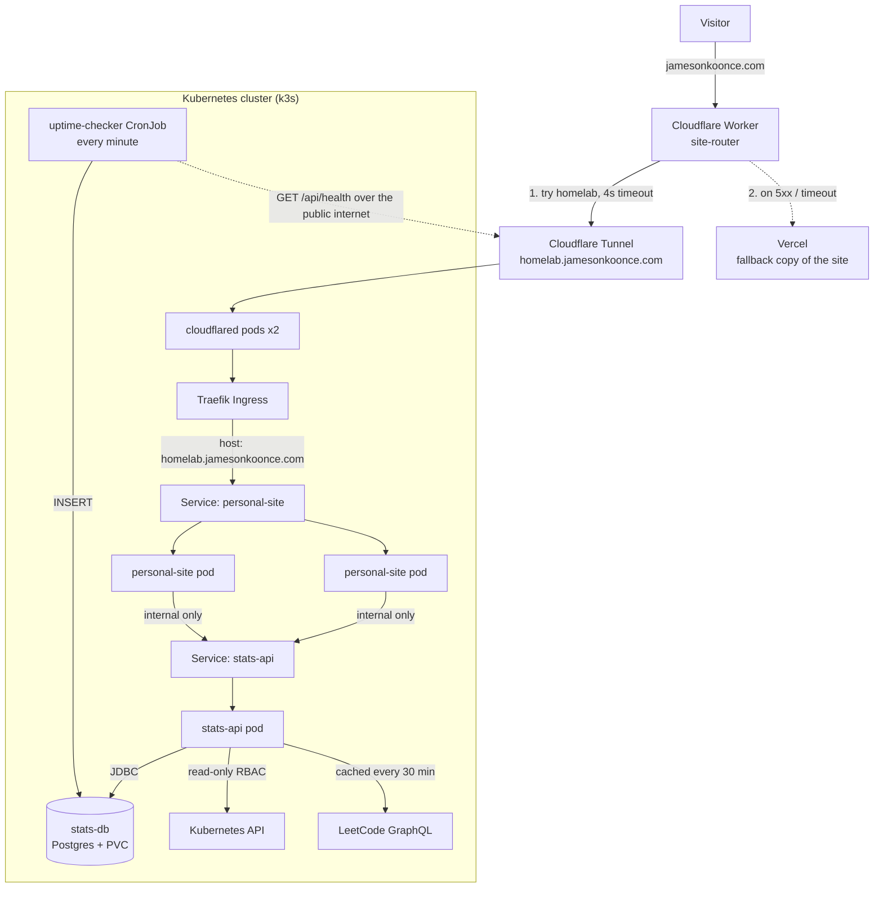

# HOMELAB

A self-hosted homelab running on Kubernetes. It serves my personal site at **[jamesonkoonce.com](https://jamesonkoonce.com)**, along with a Spring Boot stats API, a Postgres database, and an uptime monitor. It's exposed to the internet through a Cloudflare Tunnel, and Vercel takes over automatically whenever the homelab is down.

I built it to learn Docker and Kubernetes hands-on. Everything here is declared in YAML and can be rebuilt from this repo.

---

## Table of contents

- [What's running](#whats-running)
- [Architecture](#architecture)
- [Repository layout](#repository-layout)
- [Components](#components)
  - [personal-site (Next.js)](#personal-site-nextjs)
  - [stats-api (Spring Boot)](#stats-api-spring-boot)
  - [uptime-checker (CronJob)](#uptime-checker-cronjob)
  - [stats-db (Postgres)](#stats-db-postgres)
  - [cloudflared (Cloudflare Tunnel)](#cloudflared-cloudflare-tunnel)
  - [site-router (Cloudflare Worker failover)](#site-router-cloudflare-worker-failover)
- [Kubernetes resources](#kubernetes-resources)
- [Networking and routing](#networking-and-routing)
- [Security](#security)
- [How uptime is calculated](#how-uptime-is-calculated)
- [Health checks](#health-checks)
- [Setting up from scratch](#setting-up-from-scratch)
- [Deploying changes](#deploying-changes)
- [Operations cheat sheet](#operations-cheat-sheet)
- [Troubleshooting](#troubleshooting)
- [Design decisions and lessons learned](#design-decisions-and-lessons-learned)
- [Roadmap](#roadmap)

---

## What's running

| Namespace | Workload | Kind | Replicas | Purpose |
|---|---|---|---|---|
| `personal-site` | `personal-site` | Deployment | 2 | Next.js personal website |
| `stats` | `stats-api` | Deployment | 1 | Spring Boot API: LeetCode, cluster and uptime stats |
| `stats` | `stats-db` | StatefulSet | 1 | Postgres 17, stores uptime history |
| `stats` | `uptime-checker` | CronJob | every minute | Checks the public site and records the result |
| `cloudflared` | `cloudflared` | Deployment | 2 | Cloudflare Tunnel connector (outbound only) |
| `kube-system` | Traefik, CoreDNS, ... | k3s built-ins | | Ingress controller, cluster DNS, storage, metrics |

**Stack:** k3s (via k3d locally) · Docker · Next.js 14 · Node 26 · Spring Boot 4 / Java 21 · Postgres 17 · Flyway · Fabric8 Kubernetes client · Traefik · Cloudflare Tunnel · Cloudflare Workers

---

## Architecture

### Request flow



### How a page load works

1. The browser requests `https://jamesonkoonce.com`.
2. The **Cloudflare Worker** (`site-router`) forwards the request to `https://homelab.jamesonkoonce.com`.
3. That hostname belongs to a **Cloudflare Tunnel**. The `cloudflared` pods in the cluster hold an *outbound* connection to Cloudflare, so traffic comes back down it. No ports are open on my router.
4. `cloudflared` hands the request to **Traefik** (`traefik.kube-system.svc.cluster.local:80`).
5. Traefik matches the **Ingress** rule for `homelab.jamesonkoonce.com` and sends it to the `personal-site` **Service**, which load-balances across 2 pods.
6. The Next.js server renders the page, calling `stats-api` over the **internal cluster network** for live stats.
7. If anything in steps 3–6 fails (the cluster is off, the tunnel is down, or the site returns a 5xx), the Worker serves the page from **Vercel** instead.

---

## Repository layout

```
HOMELAB/
├── README.md
├── personal-site/                  # Next.js site (source + Dockerfile)
│   ├── Dockerfile                  # 3-stage build → standalone Node server
│   ├── next.config.mjs             # output: "standalone" + /legacy rewrites
│   ├── public/                     # photos, halftones, favicons, legacy site
│   └── src/app/
│       ├── page.js                 # home page (server component)
│       └── api/health/route.js     # health endpoint for k8s probes
├── stats-api/                      # Spring Boot API (source + Dockerfile)
│   ├── Dockerfile                  # 2-stage Maven build → JRE image
│   ├── pom.xml
│   └── src/main/
│       ├── java/com/jameson/stats_api/
│       │   ├── StatsController.java        # GET /api/stats, GET /api/uptime
│       │   ├── leetcode/                   # LeetCode client + 30-min cache
│       │   ├── cluster/                    # Fabric8 client + cluster stats
│       │   └── uptime/                     # uptime % calculation (JdbcClient)
│       └── resources/
│           ├── application.properties
│           └── db/migration/V1__create_uptime_checks.sql
├── uptime-checker/                 # tiny Alpine image run by the CronJob
│   ├── Dockerfile
│   └── check.sh
└── k8s/                            # all Kubernetes manifests
    ├── personal-site/              # Namespace, Deployment, Service, Ingress
    ├── cloudflared/                # Namespace, Deployment
    └── stats-api/                  # Namespace, RBAC, Deployment, Service,
                                    # Postgres StatefulSet, uptime CronJob
```

**Organizing rule:** source folders are organized **by image** (one folder builds one image), and `k8s/` folders are organized **by what gets deployed together**, which usually lines up with a namespace.

---

## Components

### personal-site (Next.js)

My personal site: Next.js 14 (App Router) with Tailwind, running as a **Node server**, not static files. It needs a server because:

- the home page is a **server component** that fetches stats on every request (`cache: "no-store"`)
- `next/image` optimizes images on the fly (via `sharp`)
- `next.config.mjs` uses **rewrites** to serve the legacy site at `/legacy`

**Container image:** a 3-stage Dockerfile:

| Stage | Base | Does |
|---|---|---|
| `deps` | `node:26-alpine` | `npm ci` from the lockfile (cached unless dependencies change) |
| `build` | `node:26-alpine` | `npm run build` with `output: "standalone"` |
| `run` | `node:26-alpine` | Copies only `.next/standalone`, `.next/static` and `public/`; runs `node server.js` as a non-root `nextjs` user |

`HOSTNAME=0.0.0.0` makes the server listen on all interfaces. Otherwise it would only listen on the container's own `localhost`, and nothing outside could reach it.

**Stats with graceful fallback.** `page.js` reads `STATS_API_URL` from the environment:

- **In the cluster**, it's set to `http://stats-api.stats.svc.cluster.local/api/stats`. The page shows a **"This Site"** section with pods running, 7-day uptime and the tech stack.
- **On Vercel**, it isn't set. The page skips the stats section and fetches the LeetCode count directly.
- The stats fetch has a **2-second timeout** (`AbortSignal.timeout`), so a slow or down API never blocks the page; the section just disappears.

**Health endpoint:** `GET /api/health` returns `{"status":"ok","uptimeSeconds":N}`. It's marked `force-dynamic`, so it runs real server code on every request instead of being pre-rendered at build time.

### stats-api (Spring Boot)

An internal API (Spring Boot 4, Java 21) that collects everything the site shows. It is **not exposed publicly**: it has no Ingress and no tunnel route.

| Endpoint | Returns |
|---|---|
| `GET /api/stats` | `leetcodeSolved`, `cluster` (nodes, pods running/total, site replicas) and `uptime` summary |
| `GET /api/uptime` | Uptime % for 24h / 7d / 30d plus the last check |
| `GET /actuator/health/{liveness,readiness}` | Kubernetes probe endpoints |

Example `/api/stats` response:

```json
{
  "leetcodeSolved": 84,
  "cluster": {
    "nodes": 1, "podsRunning": 11, "podsTotal": 15,
    "site": { "replicasReady": 2, "replicasDesired": 2, "runningSince": "2026-11-21T23:18:03Z", "restarts": 0 }
  },
  "uptime": {
    "target": "https://homelab.jamesonkoonce.com/api/health",
    "last24h": 100.0, "last7d": 100.0, "last30d": 100.0,
    "lastCheck": { "checkedAt": "2026-11-22T00:37:03Z", "up": true, "statusCode": 200, "responseMs": 206 }
  }
}
```

**How each piece works:**

- **LeetCode** (`leetcode/`): `LeetCodeClient` calls LeetCode's GraphQL API with Spring's `RestClient`. `LeetCodeService` refreshes the count with `@Scheduled(fixedRateString = "PT30M")` and keeps it in memory. API requests never call LeetCode directly, so LeetCode sees about 48 requests a day no matter how much traffic the site gets. If a refresh fails, the last known value is kept.
- **Cluster stats** (`cluster/`): uses the **Fabric8 Kubernetes client**. On a laptop it reads `~/.kube/config`; inside a pod it automatically uses the pod's **ServiceAccount** token, so it only has the permissions RBAC grants. The site's pods are found using the Deployment's own label selector.
- **Uptime** (`uptime/`): plain SQL through Spring's `JdbcClient` (no JPA). The work is counting rows over time windows, which SQL handles directly. The schema is owned by **Flyway** (`V1__create_uptime_checks.sql`).

Every section degrades independently: if the cluster API or the database can't be reached, that part of the response is `null` and the rest still works.

**Configuration** (`application.properties`, overridden by environment variables in the cluster):

| Property | Env var override | Purpose |
|---|---|---|
| `spring.datasource.url` / `username` / `password` | `SPRING_DATASOURCE_*` | Postgres connection (password from Secret) |
| `uptime.target` | `UPTIME_TARGET` | URL shown in the uptime response |
| `site.namespace` / `site.deployment` | | Which Deployment to report on |
| `leetcode.username` | `LEETCODE_USERNAME` | LeetCode account |

### uptime-checker (CronJob)

A Kubernetes **CronJob** that runs every minute, makes one HTTP request to the public site, and records the result in Postgres.

- **Image:** `alpine:3.22` with `curl` and `postgresql17-client`, plus `check.sh`, running as `nobody`. It's about 15 MB with no JVM, so starting it every minute is cheap.
- **What it checks:** `https://homelab.jamesonkoonce.com/api/health`, the **public URL**. The request goes out to the internet and back in through Cloudflare, the tunnel and Traefik, the same path a visitor takes. If the tunnel breaks while the pods are healthy, this still catches it.
- **Up** means HTTP 2xx or 3xx within 10 seconds. Anything else (502, 503, 530, a timeout, DNS failure) is recorded as down, with status `000` if it couldn't connect at all.
- **CronJob settings:**
  - `concurrencyPolicy: Forbid`: never two checks at once
  - `backoffLimit: 0`, `restartPolicy: Never`: no retries (a retry would create a duplicate row; the next minute checks again)
  - `activeDeadlineSeconds: 50`: kill a stuck check before the next one starts
  - `successfulJobsHistoryLimit: 1`, `failedJobsHistoryLimit: 1`: keeps finished pods from piling up

### stats-db (Postgres)

Postgres 17 running as a **StatefulSet** with a **PersistentVolumeClaim**.

- **Why a StatefulSet and not a Deployment:** the pod gets a stable name (`stats-db-0`) and always reattaches to the same disk. If the pod is deleted, the replacement is again `stats-db-0` with the same data.
- **Storage:** `volumeClaimTemplates` requests 1 Gi, provided by k3s's built-in `local-path` provisioner. The PVC (`data-stats-db-0`) exists separately from the pod, so the data survives pod restarts and even deleting the StatefulSet.
- **Service:** headless (`clusterIP: None`), as StatefulSets require. Clients connect to `stats-db.stats.svc.cluster.local:5432`.
- **Credentials:** all loaded from the `stats-db` Secret with `envFrom`. The same Secret is read by stats-api and the uptime checker, so all three always agree on the password.
- `PGDATA` points to a subfolder, because Postgres refuses to initialize in a non-empty directory.
- Probes use `pg_isready` through `exec`.

**Schema:**

```sql
CREATE TABLE uptime_checks (
    id          BIGSERIAL PRIMARY KEY,
    checked_at  TIMESTAMPTZ NOT NULL DEFAULT NOW(),
    target      TEXT        NOT NULL,
    up          BOOLEAN     NOT NULL,
    status_code INTEGER,
    response_ms INTEGER
);
CREATE INDEX idx_uptime_checks_checked_at ON uptime_checks (checked_at);
```

One row per minute is about 525,000 rows a year, which is small for Postgres. The index on `checked_at` keeps every "rows since X" query fast.

### cloudflared (Cloudflare Tunnel)

Two `cloudflared` pods that connect **outward** to Cloudflare and keep the tunnel open. Visitor traffic comes back down that connection.

- No open ports on the router, and my home IP is never exposed
- Cloudflare handles HTTPS: visitor → Cloudflare is TLS, while cloudflared → Traefik inside the cluster is plain HTTP
- The tunnel token lives in the `cloudflared-token` Secret (created by command, **never committed**) and is passed as `TUNNEL_TOKEN`
- `--metrics 0.0.0.0:2000` exposes `/ready`, used by both probes
- **No Service or Ingress**, because nothing connects *to* cloudflared; it only connects out
- 2 replicas, so the tunnel stays up while one restarts

**Tunnel route** (configured in the Cloudflare Zero Trust dashboard):

| Public hostname | Service |
|---|---|
| `homelab.jamesonkoonce.com` | `http://traefik.kube-system.svc.cluster.local:80` |

Cloudflare creates the `homelab` CNAME (pointing to `<tunnel-id>.cfargotunnel.com`, proxied) automatically.

### site-router (Cloudflare Worker failover)

A Cloudflare Worker on `jamesonkoonce.com/*` and `www.jamesonkoonce.com/*` that serves the homelab when it's up and **Vercel when it isn't**.

- `www` → 301 redirect to the bare domain
- `GET`/`HEAD` requests go to `https://homelab.jamesonkoonce.com` with a **4-second timeout**
- A response below 500 is served as-is. A **5xx** (including Cloudflare's **530** "tunnel down"), a timeout or a network error triggers the fallback to `https://portfolio-v2-lime-five.vercel.app`
- Every response carries an `x-served-by: homelab | vercel` header
- URLs are built with `new URL(path, base)` to avoid double slashes, which caused a 308 redirect loop on Vercel
- The route's **request-limit failure mode is "fail open"**: if the free tier's daily limit is ever exceeded, requests skip the Worker and go to the DNS record, which still points at Vercel

The Worker's DNS records (`jamesonkoonce.com`, `www`) must be **proxied** (orange cloud), since Workers only run on traffic that passes through Cloudflare.

<details>
<summary>Worker source (<code>site-router</code>)</summary>

```js
const PRIMARY = "https://homelab.jamesonkoonce.com";             // homelab, through the tunnel
const FALLBACK = "https://portfolio-v2-lime-five.vercel.app";    // Vercel
const TIMEOUT_MS = 4000;

export default {
  async fetch(request) {
    const url = new URL(request.url);

    // Send www to the bare domain
    if (url.hostname === "www.jamesonkoonce.com") {
      url.hostname = "jamesonkoonce.com";
      return Response.redirect(url.toString(), 301);
    }

    const path = url.pathname + url.search;
    const headers = new Headers(request.headers);
    headers.delete("host");

    // Only GET/HEAD are safe to retry (the site only uses these)
    const canRetry = request.method === "GET" || request.method === "HEAD";

    // 1. Try the homelab
    try {
      const res = await fetch(new URL(path, PRIMARY), {
        method: request.method,
        headers,
        body: canRetry ? undefined : request.body,
        redirect: "manual",
        signal: AbortSignal.timeout(TIMEOUT_MS),
      });
      if (res.status < 500 || !canRetry) {
        return tag(res, "homelab");
      }
    } catch (err) {
      if (!canRetry) return new Response("Service unavailable", { status: 503 });
    }

    // 2. Homelab is down or erroring: serve from Vercel
    const fallback = await fetch(new URL(path, FALLBACK), {
      method: request.method,
      headers,
      redirect: "manual",
    });
    return tag(fallback, "vercel");
  },
};

// Add a header showing which backend served the response
function tag(res, servedBy) {
  const out = new Response(res.body, res);
  out.headers.set("x-served-by", servedBy);
  return out;
}
```

</details>

---

## Kubernetes resources

| Resource | Namespace | Notes |
|---|---|---|
| `Namespace` ×3 | | `personal-site`, `stats`, `cloudflared` |
| `Deployment/personal-site` | personal-site | 2 replicas, `STATS_API_URL` env, probes on `/api/health` |
| `Service/personal-site` | personal-site | ClusterIP, port 80 → 3000 |
| `Ingress/personal-site` | personal-site | `ingressClassName: traefik`, hosts `localhost` and `homelab.jamesonkoonce.com` |
| `Deployment/cloudflared` | cloudflared | 2 replicas, token from Secret |
| `Secret/cloudflared-token` | cloudflared | **created by command, not in Git** |
| `ServiceAccount/stats-api` | stats | Identity for stats-api pods |
| `ClusterRole/stats-reader` | (cluster) | `get`, `list` on pods, nodes, deployments |
| `ClusterRoleBinding/stats-api-reads-cluster` | (cluster) | Grants `stats-reader` to the ServiceAccount |
| `Deployment/stats-api` | stats | 1 replica, startup/readiness/liveness probes |
| `Service/stats-api` | stats | ClusterIP, port 80 → 8080, **no Ingress** |
| `StatefulSet/stats-db` | stats | Postgres 17, 1 Gi PVC |
| `Service/stats-db` | stats | Headless |
| `Secret/stats-db` | stats | `POSTGRES_USER`, `POSTGRES_DB`, `POSTGRES_PASSWORD`; **created by command, not in Git** |
| `CronJob/uptime-checker` | stats | `* * * * *` |

**Object hierarchies used here:**

```
Deployment  → ReplicaSet (one per version) → Pods     # rolling updates and rollbacks
StatefulSet → Pod (stable name) + PVC (stable disk)   # databases
CronJob     → Job (one per run)            → Pod      # scheduled tasks that run to completion
```

---

## Networking and routing

### DNS (Cloudflare)

The domain is registered at Squarespace, with its nameservers pointed at Cloudflare. Squarespace is still the registrar; Cloudflare answers DNS.

| Record | Type | Points to | Proxy |
|---|---|---|---|
| `jamesonkoonce.com` | A | Vercel | Proxied (Worker intercepts it) |
| `www` | CNAME | Vercel | Proxied (Worker redirects to the apex) |
| `homelab` | CNAME | `<tunnel-id>.cfargotunnel.com` | Proxied (required for tunnels) |

### In-cluster addresses

Services find each other through cluster DNS (`<service>.<namespace>.svc.cluster.local`):

| From | To | Address |
|---|---|---|
| cloudflared | Traefik | `traefik.kube-system.svc.cluster.local:80` |
| personal-site | stats-api | `stats-api.stats.svc.cluster.local:80` |
| stats-api, uptime-checker | Postgres | `stats-db.stats.svc.cluster.local:5432` |

### Public vs internal

| Component | Reachable from the internet? |
|---|---|
| personal-site | ✅ via Worker → tunnel → Traefik → Ingress |
| stats-api | ❌ internal only (no Ingress) |
| stats-db | ❌ internal only |
| cloudflared | ❌ outbound connections only |

---

## Security

- **No inbound ports.** All public traffic arrives through the outbound Cloudflare Tunnel. The router has no port forwards, and the home IP stays hidden.
- **Secrets stay out of Git.** The tunnel token and database password are created with `kubectl create secret` and passed to pods with `secretKeyRef` / `envFrom`. They never appear in a manifest.
- **Least-privilege RBAC.** stats-api's ServiceAccount can only **read** pods, nodes and deployments: no writes, and no access to Secrets.
- **Non-root containers.** personal-site runs as `nextjs`, stats-api as `app`, and the uptime checker as `nobody`.
- **Internal services stay internal.** stats-api and Postgres have no Ingress.
- **Resource limits on every container**, so one misbehaving app can't starve the node of memory.

> **Note:** Kubernetes Secrets are base64-encoded, not encrypted, so anyone with cluster access can read them. That's acceptable for a single-user homelab; see the [roadmap](#roadmap) for improvements.

---

## How uptime is calculated

```
uptime % = successful checks ÷ minutes in the window
```

- The checker runs **once a minute**, so every minute is expected to have one row.
- **Missing minutes count as down.** This matters for self-monitoring: when the cluster is off, the checker is off too and nothing gets recorded. Counting only recorded rows would hide every full outage.
- **Time before the first check is ignored.** The window starts at whichever is later: the window start (24h / 7d / 30d ago) or the first check ever. Without this, a brand-new monitor would report 0.01% for "last 30 days."
- The result is capped at 100% (a check that runs a few seconds early can produce one extra row) and rounded to 2 decimals.

The checker measures **the homelab's** uptime (`homelab.jamesonkoonce.com`). The public domain is effectively always up thanks to the Vercel fallback, so the homelab number is the more interesting one.

---

## Health checks

| Workload | Startup | Readiness | Liveness |
|---|---|---|---|
| personal-site | (delays) | `GET /api/health` | `GET /api/health` |
| stats-api | `/actuator/health/liveness`, up to 90s | `/actuator/health/readiness` | `/actuator/health/liveness` |
| stats-db | (delays) | `pg_isready` | `pg_isready` |
| cloudflared | (delays) | `GET /ready` on :2000 | `GET /ready` on :2000 |

**Rules followed:**

- **Liveness only asks "is this process stuck?"** Failing it restarts the container, so it should be as simple as possible.
- **Probes never depend on external services.** If the site's probe called LeetCode, a LeetCode outage would fail readiness on *every* pod at once, Kubernetes would pull them all from the Service, and the whole site would go down even though it handles missing data fine.
- **Startup probes for slow starters.** The JVM takes a while to boot (longer on a Pi). A startup probe gives it time without delaying probes once it's actually ready.

---

## Setting up from scratch

### Prerequisites

- Docker
- [`kubectl`](https://kubernetes.io/docs/tasks/tools/)
- [`k3d`](https://k3d.io/) (runs k3s inside Docker)
- A Cloudflare account with the domain's DNS on Cloudflare

### 1. Create the cluster

```bash
k3d cluster create homelab -p "8080:80@loadbalancer"
kubectl config current-context    # k3d-homelab
```

`-p "8080:80@loadbalancer"` maps `localhost:8080` to Traefik. k3d creates two containers: `k3d-homelab-server-0` (the k3s node) and `k3d-homelab-serverlb` (an nginx proxy in front of it for ports 80 and 6443).

### 2. Build the images and import them into the cluster

The cluster has its own image store, separate from your laptop's Docker, so local images must be imported:

```bash
docker build -t personal-site:0.7 personal-site/
docker build -t stats-api:dev     stats-api/
docker build -t uptime-checker:dev uptime-checker/

k3d image import personal-site:0.7 stats-api:dev uptime-checker:dev -c homelab
```

Use the tags that the manifests in `k8s/` reference.

### 3. Create the Secrets (not stored in Git)

```bash
kubectl create namespace cloudflared
kubectl create secret generic cloudflared-token -n cloudflared \
  --from-literal=token=<TUNNEL_TOKEN>

kubectl create namespace stats
kubectl create secret generic stats-db -n stats \
  --from-literal=POSTGRES_USER=stats \
  --from-literal=POSTGRES_DB=stats \
  --from-literal=POSTGRES_PASSWORD="$(openssl rand -base64 24)"
```

The tunnel token is in Cloudflare Zero Trust → Networks → Tunnels → `homelab`.

### 4. Apply the manifests

```bash
kubectl apply -f k8s/personal-site/
kubectl apply -f k8s/cloudflared/
kubectl apply -f k8s/stats-api/
```

> `kubectl apply -f <folder>` processes files **alphabetically**. If a namespace file sorts after the files that use it, the first apply fails with `namespaces "…" not found`. Running it again fixes it, and naming namespace files `00-namespace.yaml` prevents it.

### 5. Check it

```bash
kubectl get pods -A
curl http://localhost:8080/api/health
curl -sI https://jamesonkoonce.com | grep -i x-served-by    # homelab
```

---

## Deploying changes

**Always use a new image tag.** Kubernetes only rolls out a change when the Deployment spec changes. Re-importing an image under the same tag makes `kubectl apply` report `unchanged`, and the old pods keep running.

```bash
# 1. Build with a new tag
docker build -t personal-site:0.8 personal-site/

# 2. Import into the cluster
k3d image import personal-site:0.8 -c homelab

# 3. Bump the tag in k8s/personal-site/deployment.yaml, then:
kubectl apply -f k8s/personal-site/            # should say "configured"
kubectl rollout status deployment/personal-site -n personal-site
```

Kubernetes performs a **rolling update**: it starts new pods, waits for readiness, then removes old ones, with no downtime.

**Rolling back:**

```bash
kubectl rollout undo deployment/personal-site -n personal-site
kubectl rollout history deployment/personal-site -n personal-site
```

**Checking what's actually live:**

```bash
kubectl get deployments -A -o wide     # IMAGES column
```

---

## Operations cheat sheet

```bash
# Cluster lifecycle
k3d cluster list
k3d cluster stop homelab        # keeps everything
k3d cluster start homelab       # pods return in ~30–60s

# What's running
kubectl get pods -A
kubectl get pods -A --field-selector=status.phase=Running
kubectl get all -n stats
kubectl get ingress -A

# Logs
kubectl logs -n personal-site deployment/personal-site
kubectl logs -f -n stats deployment/stats-api
kubectl logs -n cloudflared deployment/cloudflared --tail=20

# Call an internal service
kubectl run tmp --rm -it --image=curlimages/curl --restart=Never -- \
  curl -s http://stats-api.stats.svc.cluster.local/api/stats

# Database
kubectl exec -it -n stats stats-db-0 -- psql -U stats -d stats
kubectl port-forward -n stats pod/stats-db-0 5432:5432     # reach it from a laptop

# Run an uptime check now
kubectl create job -n stats --from=cronjob/uptime-checker manual-check

# Images inside the cluster
docker exec k3d-homelab-server-0 crictl images

# Clean up finished/failed pods
kubectl delete pods -A --field-selector=status.phase=Failed
kubectl delete pods -A --field-selector=status.phase=Succeeded
```

### Running services locally (outside Kubernetes)

```bash
# stats-api on :8081 (k3d's proxy holds :8080), using the cluster's database
kubectl port-forward -n stats pod/stats-db-0 5432:5432
SPRING_DATASOURCE_PASSWORD="$(kubectl get secret stats-db -n stats -o jsonpath='{.data.POSTGRES_PASSWORD}' | base64 -d)" \
SERVER_PORT=8081 ./mvnw spring-boot:run

# personal-site pointed at the local stats-api
STATS_API_URL=http://localhost:8081/api/stats npm run dev
```

---

## Troubleshooting

**Start with:** `kubectl get pods -A` → `kubectl describe pod` (read **Events**) → `kubectl logs` (add `--previous` after a crash).

| Symptom | Likely cause | Fix |
|---|---|---|
| `ErrImagePull` / `ImagePullBackOff` | Local image not imported into the cluster | `k3d image import <image>:<tag> -c homelab` |
| `kubectl apply` says `unchanged` after a rebuild | Same image tag | Use a new tag |
| Many `Evicted` pods, new pods `Pending` | **DiskPressure** on the node | `docker builder prune`, `docker image prune`; check `kubectl describe node` |
| Local images vanish from the cluster | Kubernetes **image garbage collection** during disk pressure | Re-import (or pull from a registry, see roadmap) |
| Pod `Running` but `0/1` | Readiness probe failing | `kubectl describe pod`, `kubectl logs` |
| Cloudflare **530 / error 1033** | Tunnel down (cluster off / cloudflared not running) | Start the cluster; check cloudflared logs |
| Cloudflare **502** | Tunnel up but can't reach Traefik | Check the tunnel route's service URL |
| Plain `404 page not found` | Traefik got it, but no Ingress `host:` matched | Check `ingress.yaml` hosts |
| `503` from Traefik | No ready pods behind the Service | `kubectl get endpointslices -n <ns>` |
| Uptime CronJob runs `Failed` | Image missing or database not ready | `kubectl logs -n stats job/<name>` |
| `jamesonkoonce.com` redirect loop | Double slash in the Worker's fallback URL | Build URLs with `new URL(path, base)` |

---

## Design decisions and lessons learned

- **k3s everywhere.** k3d runs the same k3s locally that will run on the Raspberry Pi, including Traefik, so the manifests move over unchanged.
- **Config repo pattern.** Source folders produce images; `k8s/` decides which image versions run. The two connect through a single line per app: the `image:` tag.
- **Environment variables over rebuilds.** The same image runs locally, in Compose and in Kubernetes, configured from outside (`SPRING_DATASOURCE_URL`, `STATS_API_URL`, `UPTIME_TARGET`).
- **Fail gracefully, not loudly.** Every external dependency (LeetCode, the stats API, the database, the Kubernetes API) has a timeout or fallback, and a missing piece hides one section instead of breaking the page.
- **One Secret, three consumers.** Postgres, stats-api and the checker all read `stats-db`. Secrets are namespace-scoped, which is a big reason the checker lives in the `stats` namespace rather than its own.
- **Check from the outside.** The uptime checker uses the public URL, so it catches tunnel, DNS and Ingress failures, not just "the pod is alive."
- **Add, switch, then remove.** The rename from `new.` to `homelab.jamesonkoonce.com` added the new hostname first, moved every consumer over, and removed the old one last, so the site was never down.
- **Disk space matters.** Image builds filled the root partition, triggering DiskPressure, mass evictions, and garbage collection of local-only images. Docker's data root was moved to a larger drive (`/etc/docker/daemon.json` → `"data-root"`).

---

## Roadmap

- [ ] **Raspberry Pi**: run k3s natively on a Pi booting from an SSD; move the tunnel there for 24/7 hosting
- [ ] **GHCR + multi-arch images**: `docker buildx --platform linux/amd64,linux/arm64`, so the Pi (ARM) and the laptop both pull from a registry instead of `k3d image import`
- [ ] **Pi-hole**: network-wide ad blocking via a `LoadBalancer` Service on port 53
- [ ] **Movie site**: authenticated downloads from a mounted drive, reachable privately over **Tailscale** (large video files stay off Cloudflare's proxy)
- [ ] **NetworkPolicy**: only `personal-site` may call `stats-api`
- [ ] **Kustomize**: one `kubectl apply -k` for the whole cluster, in the right order
- [ ] Pin `cloudflared` to a specific version instead of `:latest`
- [ ] Versioned tags for `stats-api` and `uptime-checker` (currently `:dev`)
- [ ] Rename `k8s/stats-api/` → `k8s/stats/` to match its namespace
- [ ] Store the Worker source in this repo and deploy it with Wrangler
- [ ] Encrypted Secrets (e.g. Sealed Secrets or SOPS)
- [ ] Uptime data retention (delete rows older than ~90 days)
